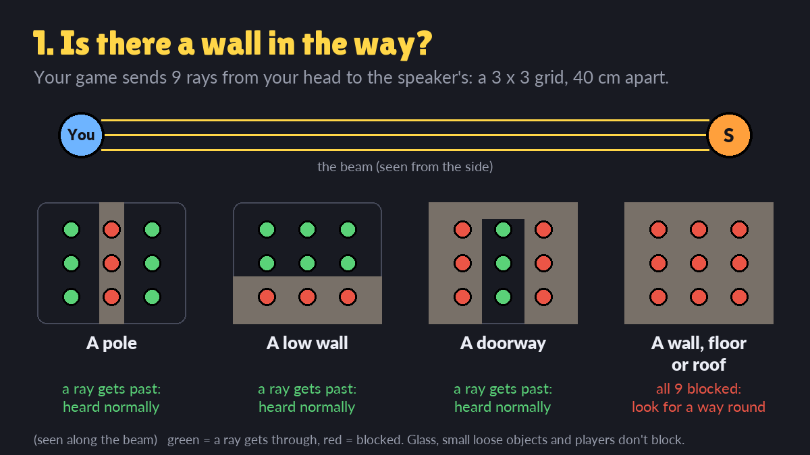
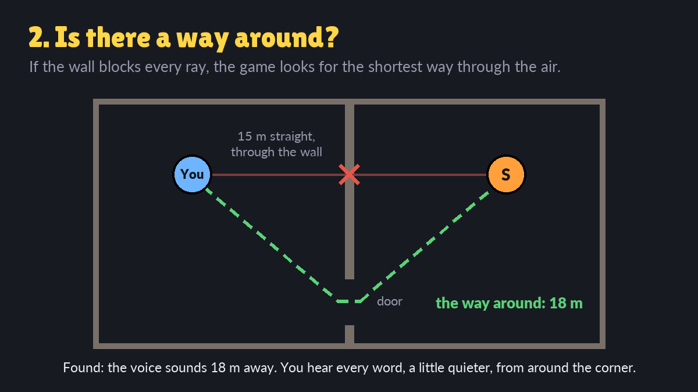
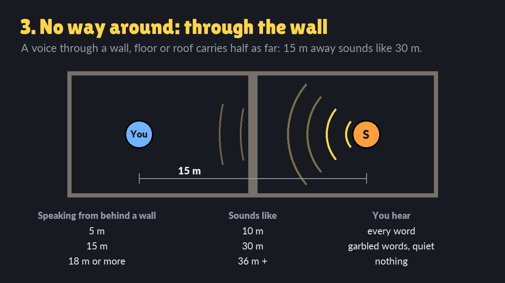

# Proximity Comms: API for mod makers

Proximity Comms (Text and Voice Chat; called Proximity Babble Chat until October 2026) is a global mod. A host turns it on for a session, and it then runs alongside
any map or game mode. Your mod can work with it through the **registry**, which every script on a
machine shares. Teardown mods can't call each other's functions, so these registry keys are the
whole interface:

| key | type | who writes it | where | what it does |
|---|---|---|---|---|
| [`proxchat.version`, `proxchat.alive`](#proxchatversion-proxchatalive) | int, float | the chat | each machine | the chat is running here (and which API version) |
| [`proxchat.lobby`](#proxchatlobby) | bool | your **server** script | host | while true, everything said goes to everyone |
| [`proxchat.noglobal`](#proxchatnoglobal) | bool | your **server** script, every tick | host | while true, nobody can chat in Global (the dead's channel still works) |
| [`proxchat.block`](#proxchatblock) | bool | your **client** script | each machine | while true, Enter does not open the chat |
| [`proxchat.open`](#proxchatopen) | bool | your **client** script | each machine | opens the chat now, as Enter would (the chat clears it) |
| [`proxchat.close`](#proxchatclose) | bool | your **client** script | each machine | closes the chat now (the chat clears it) |
| [`proxchat.key.*`](#proxchatkey-proxchattalkingplayer), [`proxchat.talking.<player>`](#proxchatkey-proxchattalkingplayer) | string, bool | the chat | each machine | the chat's keys (for your hints), and whether the talk key is held |
| [`proxchat.typing.<player>`](#proxchattypingplayer) | bool | the chat | host: every player; each machine: its own player | true while that player is typing |
| [`proxchat.ranges`](#proxchatranges) | string | your **server** script | host | sets the Whisper / Speak / Yell (and the devices') distances |
| [`proxchat.device.<name>`](#proxchatdevicename) | string | your **server** script | host | a walkie-talkie, a loudspeaker (megaphone) or a PA's speakers |
| [`proxchat.tx.<player>`](#proxchattxplayer) | string | your **server** script | host | that player talks into a channel's devices now (a walkie's button held, at a PA microphone) |
| [`proxchat.effects.<mode>`](#proxchateffectsmode), `.player.<p>` | string | your **server** script | host | how a mode, a device or one player sounds: pitch, echo, static... |
| [`proxchat.channel.<player>`](#proxchatchannelplayer) | string | your **server** script | host | `"dead"` (or `"dead red"`...): that player talks only to the same channel, and hears everyone |
| [`proxchat.hearall.<player>`](#proxchathearallplayer) | bool | your **server** script | host | that player's game is sent every Speak and Yell line, wherever they are (spectators, radios) |
| [`proxchat.team.<player>`](#pings-proxchatteamplayer-proxchatnoping) | string | your **server** script | host | that player's team: only their team sees their pings |
| [`proxchat.noping`](#pings-proxchatteamplayer-proxchatnoping) | bool | your **server** script | host | while true, nobody can ping |
| [`proxchat.pingcolor`, `.pingcolor.<player>`](#pings-proxchatteamplayer-proxchatnoping) | string | your **server** script | host | the colour of everyone's pins, or of one player's (`"r g b"`) |
| [`proxchat.aim`, `proxchat.pingskip`](#proxchataim-proxchatpingskip-steering-the-ping) | string | your **client** script, every frame | each machine | the view ray pings follow (your own camera), and bodies they pass through |
| [`proxchat.walls`](#proxchatwalls) | bool | your **server** script | host | walls, floors and roofs muffle voices, or not, on your map |
| [`proxchat.said.*`](#proxchatsaid-chat-events) | several | the chat | host | an event for every message said |
| [`proxchat.avoid.<name>`](#proxchatavoidname) | string | your **client** script, every frame | each machine | a screen rectangle speech bubbles stay out of (your HUD panels) |
| [`proxchat.hideBubbles`](#proxchathidebubbles) | bool | your **client** script, every frame | each machine | no speech bubbles while true |
| [`proxchat.problem`](#when-your-mod-gets-a-key-wrong) | string | the chat | each machine | the last mistake it found in your keys |

Everything here is optional. If the chat isn't enabled, nothing reads the keys you set and every key
you read stays `false` / `0` / `""`, so your mod works the same without it.

## Before you start

- **Server or client.** In Teardown v2 multiplayer the host runs every `server.*` function, and every
  player (the host too) runs the `client.*` functions. The registry is per machine: a value set on
  the host is not visible on a guest's machine. The table above says where each key lives.
- **Set your keys every tick.** When the chat starts on the host, it clears every `proxchat.*` key.
  Scripts start in no fixed order, so a key you set once in `init` may be wiped. Setting it in
  `tick` is cheap and always right.
- **Player ids** are the engine's: `GetAllPlayers()` on the server, `GetLocalPlayer()` on a client.
  (`Players()` is a helper from `script/include/player.lua`; it only exists if you include that
  file.)

## When your mod gets a key wrong

The chat tells you. When it finds a mistake in a `proxchat.*` key, it shows one line on that machine's
screen (`DebugPrint`), naming the key, what is wrong and how to fix it:

```
Proximity Comms: proxchat.device.walkie1: "radoi at=player:1": starts with "radoi", not the kind: radio (walkie), loudspeaker (megaphone) or pa - ignored
Proximity Comms: proxchat.range: the chat doesn't read this key - did you mean proxchat.ranges?
Proximity Comms: proxchat.channel.Bob: the last part must be a player id (a number from GetAllPlayers()), not "Bob"
Proximity Comms: proxchat.lobby: "yes" reads as false - set it with SetBool("proxchat.lobby", true)
```

It checks key names (a misspelt one gets a "did you mean"), player keys named by something other than a
player id, bools set as text, and the values of `ranges`, `device.*`, `effects.*` and `avoid.*`. A key it
can partly use still works, and the message says what was skipped. Each problem is shown once (setting
the same wrong value again stays quiet, a different wrong value is shown again), and at most 20 in a
session. The last one is also in `proxchat.problem` (a string), if your mod wants to show or log it.
Server keys are checked on the host, so that's the screen to watch.

---

## `proxchat.version`, `proxchat.alive`

**Read only, every machine.** The chat sets both every tick on every machine where it runs:
`proxchat.version` is the API version (13 = this document; 4 added the devices, 5 `proxchat.hearall` and the [trust model](#trust-what-a-game-mod-can-do-and-what-a-player-cant), 6 [`proxchat.problem`](#when-your-mod-gets-a-key-wrong), 7 [`proxchat.open`](#proxchatopen), 8 [`proxchat.close`](#proxchatclose), [`proxchat.key.*`, `proxchat.talking`](#proxchatkey-proxchattalkingplayer), 9 [pings](#pings-proxchatteamplayer-proxchatnoping), 10 a ping's reach, 11 [`proxchat.noglobal`](#proxchatnoglobal), 12 [`proxchat.aim`, `proxchat.pingskip`](#proxchataim-proxchatpingskip-steering-the-ping), 13 `proxchat.pingcolor.<player>`), `proxchat.alive` the `GetTime()` of its last
tick. The chat draws its own "Enter: chat" hint; use these for YOUR game's hints and rules that only
make sense with a chat, so players without it never see them. A key can outlive a mod, so check that
`alive` is recent:

```lua
local function chatRuns()
	return GetInt("proxchat.version") >= 2 and math.abs(GetTime() - GetFloat("proxchat.alive")) < 1   -- (3: the bubble keys below)
end

-- client: a game rule worth telling, only when players can actually talk
function client.draw()
	if chatRuns() and showRules then
		UiPush(); UiTranslate(UiCenter(), 120); UiAlign("center middle"); UiFont("bold.ttf", 26)
		UiText("Monsters hear voices. Whisper near them.")
		UiPop()
	end
end
```

```lua
-- client: no chat? offer your own fallback (a "ping" on G) instead
function client.tick(dt)
	if not chatRuns() and InputPressed("g") then ServerCall("server.ping", GetLocalPlayer()) end
end
```

## `proxchat.lobby`

**Server, bool.** While it is true, the chat is in lobby mode: every message goes to every player
(Global), wherever they stand, and players can't switch to Whisper, Speak or Yell. Use it while your
game shows a lobby or menu and players are spread out or waiting.

```lua
-- your game mode's server script
function server.tick(dt)
	SetBool("proxchat.lobby", gamePhase == "lobby")   -- every tick: back to proximity chat when the round starts
end
```

Every chat event says whether it was said in your lobby (`lobby` field, below).

## `proxchat.aim`, `proxchat.pingskip`: steering the ping

**Client, strings, every frame, since version 12.** A ping casts a ray from the player's camera to find what they point
at. If your mode draws its own camera (`SetCameraTransform`), or puts things around the player that the ray would hit
first (a creature model, invisible hit boxes), the pin lands in the wrong place. Set these on each player's machine,
every frame, and the chat reads and clears them (as [`proxchat.avoid`](#proxchatavoidname)):

- `proxchat.aim`: `"x y z dx dy dz"`, the view ray your camera is drawn with (its position and the way it looks). While
  set, pings cast along it instead of the player's camera.
- `proxchat.pingskip`: body handles separated by spaces (at most 64). The ping ray passes through them.

Not set: the player's own camera, skipping only their own body and the vehicle they sit in.

```lua
-- client: a monster's own camera, from inside its model
function client.tick(dt)
	local fwd = TransformToParentVec(myCamera, Vec(0, 0, -1))
	SetString("proxchat.aim", string.format("%f %f %f %f %f %f", myCamera.pos[1], myCamera.pos[2], myCamera.pos[3],
		fwd[1], fwd[2], fwd[3]))
	SetString("proxchat.pingskip", table.concat(myModelBodies, " "))   -- the creature model, its hit boxes
end
```

## `proxchat.noglobal`

**Server, bool, every tick, since version 11.** While it is true, **Global chat is off**: for a game where everything
said must stay local (a hidden-role or survival mode).

- The host refuses Global lines, so a modified game can't send one either.
- On each player's game the input line skips Global when cycling modes (Tab, the mode chips, a controller's L2 / R2,
  the talk key + Tab), and `/g` says no. A player who had Global selected drops to Speak, typing and talking alike,
  and their chat says "Global chat is off in this game."
- Players in a [channel](#proxchatchannelplayer) (the dead) are not affected: their channel works as before, whatever
  their mode, and they still hear everyone.
- [`proxchat.lobby`](#proxchatlobby) wins: in the lobby everything goes to everyone, whatever this says.

```lua
-- server: no Global chat while a round is on (the lobby before it still reaches everyone)
function server.tick(dt)
	SetBool("proxchat.noglobal", roundRunning)
end
```

## `proxchat.block`

**Client, bool.** While it is true on a player's machine, Enter (and a controller's chat button, the left
stick clicked twice) does not open the chat there. Set it while your own UI needs the keyboard (a text
field, a shop with typing, a name entry), so pressing Enter for your UI doesn't also open the chat line.
It doesn't close a chat line that is already open, and it doesn't stop [`proxchat.open`](#proxchatopen).

```lua
-- your client script
function client.tick(dt)
	SetBool("proxchat.block", nameEntryOpen)   -- every tick, true only while your text field is up
end
```

## `proxchat.open`

**Client, bool.** Set it to true and the chat opens on that machine, as if the player pressed Enter. On a
controller it opens with the quick-chat wheel, as the controller's own button (the left stick clicked twice)
does. The chat reads it every frame and clears it, so setting it once is enough. If the chat is already
open, nothing changes. `proxchat.block` doesn't stop it, since your mod asked for it.

Use it when your mod has the input itself. While your UI is interactive (`UiMakeInteractive()`, a lobby
or a menu screen), the game sends its keys to your script, so the chat may not see Enter or the
controller's button at all. Watch for the player's chat key yourself, or put a "Chat" button in your UI,
and hand over:

```lua
-- your client script, in draw: a lobby that covers the screen
function client.draw()
	local me = GetLocalPlayer()
	if GetBool("proxchat.typing." .. me) then return end      -- the chat is open: step aside (don't draw, not interactive)
	UiMakeInteractive()
	-- ... your lobby ...
	if InputPressed("return") or UiTextButton("Chat") then
		SetBool("proxchat.open", true)                          -- the chat opens next frame; proxchat.typing.<me> turns true
	end
end
```

Your UI should step aside while `proxchat.typing.<me>` is true: the chat is drawn by its own script, in
whatever order the engine draws mods, so it can end up under a full-screen panel. When the player closes
the chat, `proxchat.typing.<me>` turns false and your UI comes back. Check `proxchat.version >= 7` first
if you need to know the chat supports it; an older chat ignores the key.

## `proxchat.close`

**Client, bool.** Set it to true and the chat closes on that machine: the chat line, the controller's
quick-chat wheel and the chat's pages. A line the player hadn't sent yet is dropped. The chat reads it
every frame and clears it; if the chat is already closed, nothing happens. Use it when your game needs
the screen or the keys back at once: a match starting, a cutscene, a death screen. (Players close the
chat themselves with Enter or Esc, or B or the left stick clicked twice on a controller.) Since version 8.

```lua
-- your client script, when the round starts
SetBool("proxchat.close", true)
```

## `proxchat.key.*`, `proxchat.talking.<player>`

**Read only, each machine, since version 8.** The chat's keys, so your hints can name them and your
controls can keep off them:

| key | type | what |
|---|---|---|
| `proxchat.key.open` | string | the keyboard's chat key, as a name to show: `"Enter"` |
| `proxchat.key.pad` | string | a controller's chat button, as a name to show: `"L3 twice"` (the left stick clicked twice) |
| `proxchat.key.talk` | string | the voice chat's talk key, as an input name for `InputDown` (`"b"` unless the player changed it); `""` while the player's Koetama isn't running |
| `proxchat.talking.<player>` | bool | that machine's own player is holding the talk key right now |

The talk key belongs to the chat while it's held: with push to talk the player is talking, and in either
mode the talk key + Tab changes how they're heard. If your game uses the same key, ignore it while
`proxchat.talking.<me>` is true, the way you ignore keys while `proxchat.typing.<me>` is true.

```lua
-- your client script: a hint, and keeping off the talk key
local me = GetLocalPlayer()
local onPad = LastInputDevice() == 2
UiText((onPad and GetString("proxchat.key.pad") or GetString("proxchat.key.open")) .. ": chat")
if InputPressed("b") and not GetBool("proxchat.talking." .. me) then
	-- your own B action
end
```

## `proxchat.typing.<player>`

**Bool, read only.** True while that player has the chat line open. While they type, the keys they
press are meant for the chat, so your mod should ignore them. Otherwise typing "q" in a message would
also fire whatever event Q is mapped to in your game. On a player's own machine it is also true while
they move through the chat's pages with a controller (the D-pad, A and B are the chat's then; since
version 8).

- **On the host** (server or client script): every player's state.
- **On any machine** (client script): that machine's own player, `GetLocalPlayer()`. It is set the same
  frame the line opens and cleared the frame it closes, so no letter of a message reaches your keys.

The chat line takes the mouse and the engine stops walking and tools while it is open, but whether
your script's `InputPressed` still fires is not guaranteed: check this flag.

```lua
-- server: a per-player ability on Q that ignores players who are typing
function server.tick(dt)
	for _, p in ipairs(GetAllPlayers()) do
		if InputPressed("q", p) and not GetBool("proxchat.typing." .. p) then
			useAbility(p)
		end
	end
end
```

```lua
-- client: a local toggle on M that ignores your own typing
function client.tick(dt)
	if InputPressed("m") and not GetBool("proxchat.typing." .. GetLocalPlayer()) then
		musicOn = not musicOn
	end
end
```

```lua
-- server: freeze a player's movement while they type (an AFK-safe chat in a hectic mode)
function server.tick(dt)
	for _, p in ipairs(GetAllPlayers()) do
		if GetBool("proxchat.typing." .. p) then
			SetPlayerParam("walkingSpeed", 0, p)       -- an immediate param: set it every tick
		end
	end
end
```

## `proxchat.ranges`

**Server, string, in metres.** Sets how far each mode's words carry, for example for a small map or a
huge open one, and how far your [devices](#devices-walkie-talkies-megaphones-a-pa) carry. Three forms:

- `"whisper,speak,yell"`, defaults `"8,25,40"`;
- `"whisper,speak,yell,private,megaphone,pa"`, defaults `"8,25,40,6,60,45"`;
- `key=value` pairs, any of them, in any order: `"private=10 megaphone=90"`. Keys: `whisper`, `speak`, `yell`, `private`
  (walkies; also `radio`), `megaphone` (loudspeakers; also `loudspeaker`), `pa`, `reach` (below), and `ping` (how far a
  [ping](#pings-proxchatteamplayer-proxchatnoping) reaches; since version 10). What you leave out stays as it is.

The garbled zone past each range follows at the same share: Whisper +50 %, Speak +40 %, Yell +37.5 %, walkies +50 %,
loudspeakers and PA +1/3 (so the defaults garble out to 12, 35, 55, 9, 80 and 60 m). Whisper, Speak and Yell are measured
from the talker; a device's from the device (the walkie that plays it, the loudspeaker - shorter behind a carried one -,
the PA speaker nearest you). A device's own `range=` wins over these. `reach` (default 0 = any distance): a walkie plays
a talker only within this distance of them - a walkie-talkie's range, as opposed to how far its little speaker carries.

Values are rounded to whole metres: Whisper, Speak, Yell between 2 and 80 m with whisper < speak < yell; walkies 2-40,
loudspeakers and PA 5-200.
- It is applied when the string **changes**. The host can still move the distance bar in the chat's
  Settings afterwards; that wins until your string changes again.

```lua
-- a cramped indoor map: everything carries less
function server.tick(dt)
	SetString("proxchat.ranges", "5,15,30")
end
```

```lua
-- a storm: voices carry less while it lasts, back to normal after
function server.tick(dt)
	SetString("proxchat.ranges", stormActive and "4,12,20" or "8,25,40")
end
```

## `proxchat.channel.<player>`

**Server, string.** A channel name for a player who is out of the game (dead, spectating), as in
Lethal Company. Use `"dead"`, or one name per team (`"dead red"`, `"dead blue"`) so that the dead of
different teams can't talk to each other. Players with the **same** name form one channel:

- What they say reaches **only their own channel**, from anywhere, whatever mode they pick. The host
  sends it to those players alone, so nobody else's game has the text. Nobody sees a bubble or a "..."
  of theirs, nor hears their babble.
- They **hear everyone**: every Speak, Yell and Whisper of the living, in full, wherever they are.
- Their input line shows the channel ("Dead:", "Dead red:"), and their lines are tagged with it
  (`[dead]`, `[dead red]`).
- Your lobby (`proxchat.lobby`) comes first: in the lobby everyone hears everyone, the dead too.

Names are tidied to lower case and at most 24 characters. Set it every tick; `""` (or nothing) is the
normal channel.

```lua
-- server: dead players talk among themselves
function server.tick(dt)
	for _, p in ipairs(GetAllPlayers()) do
		SetString("proxchat.channel." .. p, GetPlayerHealth(p) <= 0 and "dead" or "")
	end
end
```

```lua
-- server: teams - each team's dead talk only to their own team's dead
function server.tick(dt)
	for _, p in ipairs(GetAllPlayers()) do
		local dead = GetPlayerHealth(p) <= 0
		SetString("proxchat.channel." .. p, dead and ("dead " .. teamOf(p)) or "")   -- "dead red", "dead blue"
	end
end
```

Their messages are still chat events, with `channel` set to the name, so your monsters can ignore them:

```lua
function onChat(e)
	if e.channel ~= "" then return end           -- the dead make no noise
	-- ... monsters hear the living
end
```

## `proxchat.hearall.<player>`

**Server, bool, every tick.** While it is true, the chat sends that player's game every Speak and Yell line said
anywhere on the map, in full (whispers still only to the players near enough). Use it for spectators, a radio item,
a security camera room. Only the host's registry counts: a player's own game can't ask for this.

```lua
-- server: spectators follow every conversation
function server.tick(dt)
	for _, p in ipairs(GetAllPlayers()) do
		SetBool("proxchat.hearall." .. p, isSpectating[p] == true)
	end
end
```

(Built into your own mod with `#include "chat_core.lua"`: also set `PC.hooks.everyoneHears` on the client, which
decides what that player's game shows of what it is sent.)

## Pings: `proxchat.team.<player>`, `proxchat.noping`

**Server, since version 9** (the reach: version 10). Players ping with the middle mouse button, or L1 + R1 together on a controller: a pin
where their crosshair points, for 5 seconds, with their name and the distance. Only their **team** sees it, and dead
players can't ping (a player in a [channel](#proxchatchannelplayer), or with no health left).

**How far a ping reaches** is yours to set, apart from the talk modes' distances: `"ping=<metres>"` in
[`proxchat.ranges`](#proxchatranges). Teammates within that distance of where the pinger stood see the pin in full; in
the buffer beyond it (+40 %, as Speak's) it fades out with their distance; past that they don't get it. It follows
them: a teammate walking closer while the pin is up sees it appear, one walking away sees it fade. Without `ping=` a
ping reaches the whole map. The dead (in a [channel](#proxchatchannelplayer)) see every ping.

```lua
-- server: a hidden-role mode - pins only for the people around you (a whisper's distance: 8 m, faded to 11.2 m)
function server.init()
	SetString("proxchat.ranges", "ping=8")
end
```

Who is on which team, in this order:

1. `proxchat.team.<player>`: a team name your mod sets (any text; tidied to lower case, at most 24 characters).
   Players with the same name are one team.
2. Otherwise the player's forced colour: the game's own team modes colour every player in their team's colour
   (`SetPlayerColor`), so players in the same colour are one team. Nothing to do if your mode uses mplib's teams.
3. Otherwise no team: every player without a team sees the ping (sandbox, co-op, free for all).

```lua
-- server: your own teams
function server.tick(dt)
	for _, p in ipairs(GetAllPlayers()) do
		SetString("proxchat.team." .. p, teamOf(p))          -- "red", "blue"; "" = no team
	end
end
```

**Pin colours** (since version 13), `"r g b"`, 0 to 1 each as `SetPlayerColor` takes them (0 to 255 works too):

- `proxchat.pingcolor.<player>` colours that player's pins, for everyone who sees them: any player, any colour (a
  team's colour, a role's, one of their own).
- `proxchat.pingcolor` colours everyone's pins; a player's own key wins over it.
- Neither: a pin takes the player's forced team colour, else the chat's yellow.

```lua
-- server: red and blue pins
function server.tick(dt)
	for _, p in ipairs(GetAllPlayers()) do
		SetString("proxchat.team." .. p, teamOf(p))
		SetString("proxchat.pingcolor." .. p, teamOf(p) == "red" and "1 0.25 0.2" or "0.2 0.55 1")
	end
end
```

`proxchat.noping` turns pings off for everyone while it is true, for a free-for-all mode where a pin would give a
player away:

```lua
-- server
function server.init()
	SetBool("proxchat.noping", true)
end
```

## `proxchat.walls`





Walls, floors and roofs can muffle voices. This is **off by default**; the host can turn it on in the
chat's Settings ("Walls muffle voices", for everyone).

**Server, bool.** Your map or game mode can decide instead: set `proxchat.walls` to `true` (on, whatever
the host chose) or `false` (off) every tick. While you set it, the host's row says "by the
game". Stop setting it and the host's choice applies again.

Each player's game works out how far a speaker **sounds**, and that decides both the words they make
out and the babble's volume:

1. **Is there a wall?** A beam of 9 parallel rays (3 x 3, 0.4 m apart) from the listener's head to the
   speaker's, against the static world above the debris size. Glass doesn't count. If any ray gets
   through, there is no wall: a pole, a railing, a low wall or a doorway on the line doesn't muffle.
2. **Is there a way round?** If all 9 are blocked, the engine's path planner looks for the shortest
   way through the air: a door to the side, a window, over the wall, down a corridor. Found: the voice
   sounds as far away as that way is long, so it comes round the corner, a little quieter.
3. **Otherwise, through the wall:** the voice carries half as far (a wall at 15 m sounds like 30 m).

The way round never counts as nearer than the speaker really is, and never as farther than through the
wall. It costs nothing while nobody talks: the beam runs 4 times a second per speaker with a message up,
and the way round at most once a second per speaker, 2 at a time, never longer than that voice carries
(Whisper 12 m, Speak 35 m, Yell 55 m at the defaults). A speaker too far away to hear is not checked.

```lua
-- server: a horror castle - walls always muffle, whatever the host chose
function server.tick(dt)
	SetBool("proxchat.walls", true)
end
```

```lua
-- server: a radio game mode where everyone carries a walkie-talkie - walls never muffle
function server.tick(dt)
	SetBool("proxchat.walls", false)
end
```

## `proxchat.said.*`: chat events

**Host only, read only.** Every message is also written to the host's registry as an event, so your
game can react to what players say and where they say it: monsters that hear yelling, guards that
notice whispers, a typed answer to a riddle, a vote. The last 16 events are kept in a ring:

| key | type | value |
|---|---|---|
| `proxchat.said.last` | int | the newest event number (counts up) |
| `proxchat.said.<n % 16>.player` | int | who said it |
| `... .mode` | string | `"whisper"`, `"speak"`, `"yell"` or `"global"` |
| `... .yell` | bool | `mode == "yell"` |
| `... .text` | string | the message (cleaned: no invisible or direction-changing characters) |
| `... .x`, `.y`, `.z` | float | where the speaker stood (feet) |
| `... .radius` | float | m: how far anyone hears anything, the babble included (defaults: whisper 12, speak 35, yell 55; global 0) |
| `... .wordsRadius` | float | m: how far the words are heard clearly (defaults: whisper 8, speak 25, yell 40; global 0) |
| `... .lobby` | bool | said while `proxchat.lobby` was true |
| `... .time` | float | the host's `GetTime()` when it was said |
| `... .channel` | string | the speaker's channel (`"dead"`, `"dead red"`...: only that channel heard it), else `""` |
| `... .tx` | string | the device channel it also went out on (`proxchat.tx.<player>`), else `""` |
| `... .device` | string | that channel's kind: `"radio"`, `"loudspeaker"` or `"pa"`, else `""` |

The radii are the distances in use when the message was said, so they follow the host's settings
and `proxchat.ranges`. Whisper, Speak and Yell lines are events too: the chat sends their text only to the
players near enough (the garbled zone plus a margin to walk in while the bubble is up: +2 m, +20 m, +25 m by
default; only Global lines go to everyone), but the host's scripts see every event.

### Reading events

Keep the last number you handled, and each tick handle every newer one. The ring holds 16: if more
than 16 messages arrive between two reads, the oldest are lost. Each player can send about two
messages a second, so a read every tick never misses one.

The chat clears its events when a level starts. A line said just before the level loaded can still be
there for your script's first moment; its `time` is from the previous level's clock (larger than
`GetTime()` or far older). To react only to fresh lines, check `time`:

```lua
local fresh = math.abs(GetTime() - GetFloat(k .. "time")) < 1      -- said in the last second
```

The reader:

```lua
local saidSeen = nil

function server.tick(dt)
	local last = GetInt("proxchat.said.last")
	if saidSeen == nil or last < saidSeen then saidSeen = last end   -- (first tick, or the chat restarted)
	for n = math.max(saidSeen + 1, last - 15), last do
		local k = "proxchat.said." .. (n % 16) .. "."
		onChat({
			player = GetInt(k .. "player"),
			mode = GetString(k .. "mode"),
			text = GetString(k .. "text"),
			pos = Vec(GetFloat(k .. "x"), GetFloat(k .. "y"), GetFloat(k .. "z")),
			radius = GetFloat(k .. "radius"),
			wordsRadius = GetFloat(k .. "wordsRadius"),
			lobby = GetBool(k .. "lobby"),
			channel = GetString(k .. "channel"),
			time = GetFloat(k .. "time"),
		})
	end
	saidSeen = last
end
```

The examples below are `onChat` functions for that reader.

### Monsters that hear players

```lua
-- every monster within earshot turns toward the speaker; a yell enrages them
function onChat(e)
	if e.mode == "global" or e.lobby or e.channel ~= "" then return end
	for _, m in ipairs(monsters) do
		local d = VecLength(VecSub(GetBodyTransform(m.body).pos, e.pos))
		if d <= e.radius then
			m.target = e.pos                  -- go and look
			if e.mode == "yell" then m.angry = true end
		end
	end
end
```

### Guards that notice whispers (stealth)

```lua
-- whispering is quiet, not silent: a guard right next to you still hears it
function onChat(e)
	if e.mode ~= "whisper" then return end
	for _, g in ipairs(guards) do
		local d = VecLength(VecSub(GetBodyTransform(g.body).pos, e.pos))
		if d <= e.wordsRadius * 0.5 then
			raiseAlarm(g, e.player)
		end
	end
end
```

### Answers and commands typed in chat

```lua
-- a riddle: the first player to say the answer (any mode, any case) wins the round
function onChat(e)
	if roundOver then return end
	if e.text:lower():find("echo", 1, true) then
		roundOver = true
		awardPoint(e.player)
	end
end
```

```lua
-- "!ready" in chat marks a player ready while the lobby is up
function onChat(e)
	if e.lobby and e.text:lower() == "!ready" then
		ready[e.player] = true
	end
end
```

---

## Devices: walkie-talkies, megaphones, a PA

Your game can give players things a voice comes out of: walkie-talkies, a megaphone, a castle's PA. The chat's own modes
stay Whisper, Speak, Yell and Global. Devices exist only when your game declares them, and players talk into them only
while your game says so. **Server script on the host, every tick**, like the rest. Your lobby comes first (everyone hears
everyone, no devices), and the dead (`proxchat.channel.<p>`) talk only to their channel: no device carries them.

| kind | what it is | sound (with Koetama) | its bubble |
|---|---|---|---|
| `radio` | a walkie-talkie ("Private") | Koetama's `radio` preset: narrow, hiss, a click and a squelch | a dotted outline and a small walkie |
| `loudspeaker` | a megaphone, an intercom horn, a car's radio | `loudspeaker`: hard, ringing; carried by a player, it points where they look | jagged, red |
| `pa` | a PA system's speakers | `pa`: fuller, the farther speakers echo, the hall's reverb | a second ring and a "PA" tag |

### `proxchat.device.<name>`

**Server, string.** A device, under any name of yours (letters, digits, `_`; no dots):

    "<kind> [channel=<channel>] at=<where> [range=<near>,<far>] [signal=<0..1>] [reverb=<0..1>]"

| part | what |
|---|---|
| kind | `radio` (also `walkie`), `loudspeaker` (also `megaphone`) or `pa` |
| `channel=` | which talk it plays (lower case, no spaces). Default: `private`, `megaphone` or `pa` |
| `at=` | `player:<p>`: carried by player p (at their chest); `body:<handle>`: moves with a body (a walkie on the floor, a car's radio); `x,y,z`: a spot; `x,y,z;x,y,z;...`: several spots that play together (up to 16: a PA's speakers) |
| `range=` | how far it is heard: full loudness to `near`, nothing past `far`; its words to far / (1 + buffer), garbled to `far`. Default: the kind's ([`proxchat.ranges`](#proxchatranges)) |
| `signal=` | a walkie's reception, 0..1 (lower: more static, words breaking up) |
| `reverb=` | the room around it, 0..1 |

`""` removes it (its bubbles go at once). A walkie never plays the player who carries it (it can't receive while it
sends); a loudspeaker a player carries does - that is a megaphone. It points where its holder looks: straight behind it
the sound is down to 15 %, and its words reach that much less far behind it too.

### `proxchat.tx.<player>`

**Server, string.** A channel player p talks into **now**: the walkie's talk button held, standing at the PA microphone,
a megaphone raised. While it is set, what p says - their voice, and their lines, typed or spoken, in Whisper, Speak or
Yell (not Global) - also comes out of every device of that channel: `""` (or nothing) stops it. Around p their own voice
carries as usual. A spoken line still counts when its end arrives after the button is let go. A channel with no device
plays nowhere.

**What each player sees and hears.** A player within a device's range gets the line in a bubble **over the device**, in
its style, the way a speaker's bubble sits over them: over a walkie on the floor, over a player who carries a walkie or a
megaphone (above their head), over the nearest PA speaker in range (one bubble per PA, not one per speaker). It is
revealed by the device's range as a talker's bubble is by theirs: words within range, ⬚ boxes across its buffer, filling
in as you walk closer; a spoken line, only the words said while you were in reach of the device. Off screen, it sits on
the screen's edge like any bubble. Your **own** walkie's bubble follows the "Your own bubble" rule: shown above you in
third person; in first person the chat's feed shows the line. Each player gets at most 3 device bubbles a line (the
nearest). A talker and the megaphone they carry never show two bubbles: the fuller one shows (the megaphone's when both
are as full) - in front of the horn its bubble, behind it (where it reaches less far) often the talker's own. A typed line also babbles from the device,
and the history tags it (`[speak via walkie]`). With Koetama, the voice itself comes out of the device too.

### `proxchat.effects.<mode>`

**Server, string.** How a voice sounds, with Koetama's sound effects (its PROTOCOL.md, "Sound effects"):
`"key=value key=value ..."` with Koetama's names - `band=<lo>,<hi>` (Hz), `drive`, `compress`, `static`, `crackle`,
`squelch`, `horn`, `lofi`, `wobble`, `reverb`, `hum` (0..1), `pitch` (semitones, -12..12), `robot` (Hz),
`echo=<seconds>` or `echo=<seconds>,<feedback>`. `off`, `0`, `false`: that effect off. `""`: back to the defaults.

- `<mode>`: `whisper`, `speak`, `yell` (a player's own voice: no effects by default), `dead` (the dead heard by the
  dead), and the devices: `private` (walkies; Koetama's `radio` preset), `megaphone` (loudspeakers), `pa`. A device's
  effects change its preset (what you don't give stays).
- `proxchat.effects.player.<p>`: one player's own (a robot character), over their mode's, on their voice and their
  devices.

### Examples

```lua
-- server: walkie-talkies. Players with one hear the others' on the channel "team", from their own hand; R held talks
-- into it (not while they type).
function server.tick(dt)
	for _, p in ipairs(GetAllPlayers()) do
		local has = hasWalkie[p]                               -- (your game's items)
		SetString("proxchat.device.walkie" .. p, has and ("radio channel=team at=player:" .. p) or "")
		local talk = has and InputDown("r", p) and not GetBool("proxchat.typing." .. p)
		SetString("proxchat.tx." .. p, talk and "team" or "")
	end
end
```

```lua
-- server: the castle's PA - four speakers in the great hall, a microphone at the gate. Whoever stands at the
-- microphone talks over it; everyone near a speaker hears it, with the hall's echo.
local MIC = Vec(12, 0, -40)
function server.tick(dt)
	SetString("proxchat.device.hall", "pa at=10,6,0;40,6,0;70,6,30;70,6,70 reverb=0.8")
	for _, p in ipairs(GetAllPlayers()) do
		local atMic = VecLength(VecSub(GetPlayerTransform(p).pos, MIC)) < 2
		SetString("proxchat.tx." .. p, atMic and "pa" or "")
	end
end
```

```lua
-- server: a megaphone item - raised (right mouse held), its holder's voice carries 60 m ahead of them
function server.tick(dt)
	for _, p in ipairs(GetAllPlayers()) do
		local has = holdsMegaphone[p]
		SetString("proxchat.device.mega" .. p, has and ("loudspeaker channel=mega" .. p .. " at=player:" .. p) or "")
		SetString("proxchat.tx." .. p, (has and InputDown("rmb", p)) and ("mega" .. p) or "")
	end
end
```

```lua
-- server: sounds - the dead as ghosts, old battered walkies, one robot player
function server.tick(dt)
	SetString("proxchat.effects.dead", "pitch=-3 reverb=0.7 wobble=0.4")
	SetString("proxchat.effects.private", "static=0.4 crackle=0.3 band=500,2500")
	SetString("proxchat.effects.player." .. robotPlayer, "robot=60 pitch=-2")
end
```

```lua
-- server: walkies reach 150 m and are heard 4 m around them; megaphones carry 120 m
function server.tick(dt)
	SetString("proxchat.ranges", "private=4 megaphone=120 reach=150")
end
```

Try them alone, with Koetama running: `/dummy voice walkie` (a voice dummy 50 m away talks into its walkie, you hear it
from yours), `/dummy voice megaphone` (pointed at you: walk behind it), `/dummy voice pa` (four speakers around you).
They declare their own devices, only in your game.

---

## Trust: what a game mod can do, and what a player can't

Since API version 5 (2026-10-09, after a security audit):

- **Mods on the host are trusted.** Everything in this document that says "server" is read from the HOST's registry,
  which only scripts running on the host can write. A game mod there can open the lobby, make anyone a spectator
  (`proxchat.hearall`, `proxchat.channel`), put a player's voice on any device (`proxchat.tx`), read every line said,
  whispers and the dead's channels included (`proxchat.said.*`), and write those keys too. Enable only mods you trust
  as host: the chat can't tell one host mod from another.
- **A player's own game is not trusted.** Teardown's `ServerCall` says nothing about who sent it, so a modified game
  could claim any player id. The chat therefore gives every player a session token, made by the host from host-only
  entropy and sent to that player alone (`ClientCall`); every call to the host carries the caller's id and token, and
  the host refuses calls whose token doesn't match or whose id is not a player in the session. So a player can't speak
  as someone else (lines, live words, typing, their voice mode), can't make up players, can't change the host's
  settings (distances, walls, voice server: the host's own game writes those into the host's registry), can't ask to
  hear every line (`proxchat.hearall` is the game's call), and can't choose the voice room while the host has one of
  its own. What still holds: lines are sent in full to the players within the garbled zone plus a margin, so a
  modified game can read a line its player would only see garbled; and every player in a voice room has its key.
- **Text is plain.** Messages and names are cleaned on the host: invisible characters and direction overrides go,
  UiText's `[[...]]` markup can't be written (`[[` becomes `[ [`), a name with nothing visible becomes "Player <id>",
  and two players whose names look alike are shown with their numbers ("Bob #3"). If your mod draws
  `proxchat.said.*.text` or player names with `UiText`, call `UiTextDisableWildcards(true)` first all the same.
- **Your own keys:** set them every tick from your server script. A client script on a guest's machine writes only
  that machine's registry, which the host never reads.

---

## `proxchat.avoid.<name>`

**Client, string, every frame.** Speech bubbles float over players' heads, so they can end up on top of
your HUD: a scoreboard, a map, a shop panel. The engine draws each mod's UI in its own order, and no mod
can put its UI above or below another's. Instead, tell the chat where your panel is, and the bubbles move
out of it: above or below it, or beside it if it is too tall.

The value is `"x y w h"`: the panel's rectangle in UI units from the screen's top left, the same units as
`UiWidth()` and `UiHeight()` in your `draw` before any `UiTranslate`. `<name>` is any word of yours, so
several panels can each have one.

Set it **every frame while the panel is on screen**, from the same `draw` that draws it. The chat reads and
removes the key each frame, so when your panel closes, you just stop setting it. Nothing is left behind, even
if your mod stops.

```lua
-- your client script
function client.draw()
	if boardOpen then
		local x, y, w, h = UiWidth() - 520, 120, 480, 600
		UiPush(); UiTranslate(x, y); drawBoard(w, h); UiPop()
		SetString("proxchat.avoid.board", x .. " " .. y .. " " .. w .. " " .. h)
	end
end
```

A bubble that had to move aside is no longer over its speaker, so it loses its little line to their head,
as bubbles pinned to the screen's edge do.

## `proxchat.hideBubbles`

**Client, bool, every frame.** While you set it, no speech bubbles are drawn at all: for a full-screen
menu, a cutscene or a results screen. The chat history and the sounds go on as usual. As with
`proxchat.avoid`, the chat removes the key each frame, so set it every frame you want them hidden.

```lua
-- your client script
function client.draw()
	if resultsScreenUp then SetBool("proxchat.hideBubbles", true) end
end
```

## Advanced: building the chat into your own mod

`chat_core.lua` can also be included in your own script, if your mod should ship with a chat
instead of relying on the host enabling Proximity Comms. Don't do both: with the global mod
also enabled, players get two chats. For most mods the registry keys above are the better choice.

Copy `chat_core.lua`, `snd/` and `fonts/` into your mod, then:

```lua
#version 2
PC = {cfg = {chatR = 20, maxLen = 120}}   -- optional: overrides, before the include
#include "chat_core.lua"

PC.hooks.inLobby = function() return gamePhase == "lobby" end   -- server
PC.hooks.blockKeys = function() return nameEntryOpen end        -- client

function server.init() PC.serverInit() end
function server.tick(dt) PC.serverTick(dt) end
function client.init() PC.clientInit() end
function client.tick(dt) PC.clientTick(dt) end
function client.draw() PC.draw() end
```

Mode ids in this API are single letters, as in the chat commands (`/w`, `/s`, `/y`, `/g`): `"w"` Whisper,
`"s"` Speak, `"y"` Yell, `"g"` Global. (`"p"`, the old id for Speak, still works. The devices come with `devices.lua`:
include it after `chat_core.lua` and `voice.lua`.)

| function | side | what |
|---|---|---|
| `PC.say(text, mode)` | client | say something as the local player; `mode` defaults to the line's current mode |
| `PC.mode()` / `PC.setMode(m)` | client | the input line's mode (`setMode` saves it as the player's default) |
| `PC.isTyping(p)` | both | server: any player; client: the local player |
| `PC.system(text)` | client | add a line only the local player sees |
| `PC.history([mode])` | client | the local history, oldest first (entries: `name`, `text`, `p`, `ch`, `far`, `sys`, `t`); with a mode, a filtered copy |
| `PC.setVoice(i)` | client | pick voice `i` (1 Squeaky, 2 Chirpy, 3 Plain, 4 Low, 5 Deep, 6 Robot) |
| `PC.page()` / `PC.setPage(pg)` | client | the chat window's page, `"chat"` or `"settings"` |

| hook (`PC.hooks.*`) | side | what |
|---|---|---|
| `inLobby()` | server | true: everything said goes to everyone (like `proxchat.lobby`) |
| `blockKeys()` | client | true: Enter does not open the chat (like `proxchat.block`) |
| `everyoneHears(speaker)` | client | true: the local player hears this speaker's Speak / Yell in full from anywhere (spectators, radios); whispers still need the whisper range. The host sends that player every Speak / Yell line only while your server script sets [`proxchat.hearall.<player>`](#proxchathearallplayer) |
| `onMessage(msg, heard)` | client | a message arrived: `msg = {id, p, name, ch, text}` (`ch`: the mode id, `"d"` from a channel), `heard` = the words this player made out (garbled in the buffer zone), or nil |
| `log(line)` | server | diagnostics |

```lua
-- client: a radio item - while you hold it, you hear your squad from anywhere
PC.hooks.everyoneHears = function(speaker)
	return holdingRadio and sameSquad(GetLocalPlayer(), speaker)
end
-- server: ... and the host sends that player every line while they hold it
function server.tick(dt)
	for _, p in ipairs(GetAllPlayers()) do SetBool("proxchat.hearall." .. p, holdsRadio[p] == true) end
end

-- client: a subtitle log of what you heard, for your own HUD
PC.hooks.onMessage = function(msg, heard)
	if heard then addSubtitle(msg.name .. ": " .. heard) end
end
```

The full option list (`PC.cfg`) and more notes are at the top of `chat_core.lua`.
